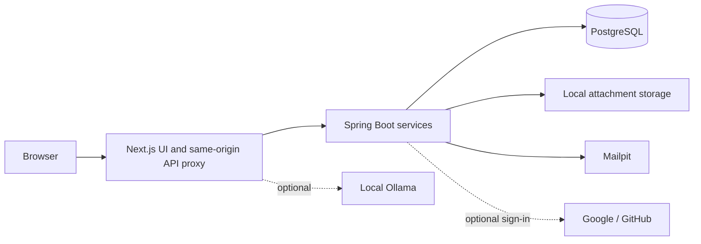

<p align="center">
  
</p>

# Deadlinr

A student workspace for tasks, deadlines and notes. Plan your day, capture a task
in plain English, and keep the relevant course material beside it.

The core app runs locally without API keys or paid services. Google/GitHub login
and an optional local AI model can be enabled separately.

## Features

- **Tasks and events:** priorities, labels, subtasks, recurrence, reminders,
  linked pages, bulk edits, undo and restore from Trash.
- **Quick capture:** type `Report due Friday 18:00 #work p1`, review the parsed
  fields, edit them and save. Parsing is deterministic and works offline.
- **Planning views:** Overview, Today, task lists, calendar, priority matrix and
  completion statistics, using the workspace's actual data.
- **Pages:** nested notes, favorites, a block editor, autosave, search and local
  image/file attachments with server-side validation.
- **Export:** versioned JSON with stable IDs and optional embedded attachments,
  task CSV and readable Markdown. CSV output escapes values and guards formulas.
- **Timezones:** UTC instants plus IANA zone IDs preserve deadline moments.
- **Authentication:** email/password, rotating refresh cookies, explicit
  Google/GitHub account linking and login rate limits.
- **Interface:** light/dark themes, compact density, keyboard shortcuts and
  virtualized task/page lists.

## Stack and architecture

| Layer | Technology | Why |
| --- | --- | --- |
| Web | Next.js 15, React 18, TypeScript | Typed routes and reusable components |
| UI | Tailwind CSS, Radix/shadcn primitives | Shared tokens and accessible controls |
| Client data | TanStack Query | Request caching and mutation invalidation |
| Editor/calendar | BlockNote, FullCalendar | Established editing and scheduling tools |
| API | Java 21, Spring Boot 3.3 | Validation, security and transactional services |
| Storage | PostgreSQL 16, JPA/JDBC, Flyway | Relational ownership and explicit migrations |
| Parsing | chrono-node | Offline natural-language date capture |
| Tests | Playwright, JUnit, Testcontainers | Browser behavior and real PostgreSQL tests |
| Monitoring | Actuator, Prometheus, Grafana | Local request, JVM and reminder metrics |



Components call shared hooks; hooks use `frontend/src/lib/api.ts`. The backend
enforces ownership and validation before persistence. Pages store editor JSON
and derived searchable text. Tasks store timestamps as UTC instants with their
IANA timezone. Parser/AI providers sit behind interfaces.

## Run locally

Install **Docker Desktop** and **Node.js 20+**. Java 21 and Maven 3.9+ are needed
only for native backend development or backend tests.

1. Clone and enter the repository:

   ```bash
   git clone https://github.com/Kojizz/Deadlinr.git
   cd Deadlinr
   ```

2. Start the backend and local services:

   ```bash
   docker compose --profile app up --build -d
   ```

3. Start the frontend in another terminal:

   ```bash
   cd frontend
   npm ci
   npm run dev
   ```

4. Open [localhost:3000](http://localhost:3000), create an account and start planning.

The first dependency/image download needs internet. Once cached, the core local
app works offline. PostgreSQL uses port **5433** to coexist with a native database.
Database and attachment volumes persist between container restarts.

### Native development and IntelliJ

Start the dependencies with `docker compose up -d`. Import `backend/pom.xml` into
IntelliJ and run **Deadlinr Local**, or use the existing `DeadlinrApplication`
configuration with the repository root as its working directory. The optional
`config/application.properties` import loads `backend/.env.local` without storing
credentials in the shared run configuration.

For a native terminal backend:

```bash
cd backend
mvn spring-boot:run
```

Do not run native and Docker backends on port 8080 together. The Maven command
above uses the backend directory for relative attachment storage; IntelliJ's
shared configuration uses the repository root. Keep your chosen working directory
consistent when restarting an existing workspace.

Windows can also run an already-built JAR from the repository root:

```powershell
./scripts/start-local-backend.ps1
```

This optional launcher expects `backend/.env.local` and a JAR built with
`mvn package` in `backend/`. It refuses an occupied port. Use `-Check` to validate
configuration without starting a server, or `-JavaPath` to select Java.

### Configuration

| File | Purpose |
| --- | --- |
| `.env.example` | Root Docker Compose/native environment reference |
| `backend/.env.example` | Blank optional OAuth configuration |
| `frontend/.env.example` | Same-origin frontend API setting |

Real `.env` files, local attachments, generated reports and IDE state are ignored
by Git. Native Spring reads process environment variables; it does not read the
root Compose `.env` automatically. Local defaults are intended for a demo.

## Optional Google/GitHub sign-in

Create your own provider applications; credentials are never included in this
repository. Set `APP_OAUTH_ENABLED=true`, `APP_PUBLIC_URL=http://localhost:3000`
and the corresponding client ID/secret.

| Provider | Registration | Callback |
| --- | --- | --- |
| Google | Web application in Google Auth Platform; configure consent/test users | `http://localhost:3000/api/auth/oauth2/callback/google` |
| GitHub | OAuth App; homepage `http://localhost:3000` | `http://localhost:3000/api/auth/oauth2/callback/github` |

For IntelliJ, copy `backend/.env.example` to `backend/.env.local` and fill it in.
For Docker, put the variables in a root `.env` and restart the backend container.
Never use `NEXT_PUBLIC_*` for secrets.

Check [provider readiness](http://localhost:3000/api/auth/oauth2/providers): configured
providers return `true`. If your provider email already owns a local workspace,
sign in with its password and connect the provider in **Settings → Connected
accounts**. Matching emails are never merged automatically.

Google requests OpenID profile/email; GitHub requests `read:user` and `user:email`,
without repository access. Social sign-in needs internet. Existing password
accounts keep local sign-in; a new provider-only account needs its provider for
the next fresh login.

## Commands and checks

Run frontend commands from `frontend/`:

```bash
npm run lint
npm run typecheck
npm test
npm run test:capture
npm run build
npm start
```

`npm test` runs parser/timezone/local-AI unit tests. `test:capture` checks auth,
account linking, quick capture, exports and item details with controlled local API
fixtures. Install the Playwright browser once with `npx playwright install chromium`.
`npm run e2e` exercises real API flows and needs PostgreSQL and Maven.

Run backend tests from `backend/`:

```bash
mvn verify
```

Testcontainers creates disposable PostgreSQL databases. No test should use a
personal workspace database. CI runs backend verification and frontend lint,
unit tests, production build and typecheck. Run typecheck after Next.js builds or
browser-server startup finishes because Next regenerates route types.

Useful developer commands: `npm run api:generate`, `npm run api:check`,
`npm run analyze`, and `npm run deps:check`. The API commands need a running backend.
`npm run seed:dev` creates a separate throwaway account for performance testing;
it does not reset existing accounts.

## Repository layout

```text
.github/workflows/       CI
.run/                   Shared IntelliJ launch configuration
backend/                Spring Boot API, migrations and tests
config/                 Optional local configuration import
frontend/
  src/app/              App Router screens and local AI route
  src/components/       Planner, editor, auth, settings and UI primitives
  src/hooks/            Workspace/auth/query hooks
  src/lib/              API client, date conversion and offline parser
  unit/                 Parser, timezone and local-model tests
  capture-tests/        Isolated browser regressions
  e2e/                  Real-backend browser tests
grafana/                Local dashboards and provisioning
prometheus/             Metrics scrape configuration
samples/                JSON, CSV and readable export fixtures
scripts/                Local backend launcher
```

## Two-minute demo

1. **Capture:** open quick add with Ctrl/Cmd+K or `q`, type the example phrase,
   edit its preview and save. Reopen it to show deadline, timezone and priority.
2. **Plan:** open Today or Calendar, then use the details panel to edit properties
   and add a subtask.
3. **Connect notes:** create a nested page, add text/an image, reload it and show
   the linked task.
4. **Export:** open Settings → Data, export JSON with attachments, then show the
   task CSV and readable output in `samples/`.

Search uses Ctrl/Cmd+Shift+K. Press `?` in the app for the current shortcut list.

## Limitations and next steps

- Natural-language parsing currently targets English; ambiguous input needs review.
- The app is a local portfolio demo. Public deployment needs HTTPS, a private JWT
  signing key, restricted CORS/metrics access and a production CSP.
- OAuth registration belongs to the person running the app. Google testing-mode
  accounts may need to be added to its test-user list.
- Import with review/undo, syllabus extraction and an ICS subscription feed remain
  roadmap items; the current data feature exports tasks and pages.
- Ollama is optional and must already have a compatible local model. Its absence
  never blocks normal task capture.

## Development conventions

Keep feature folders and the existing component style. Reuse the shared API client
and hooks. Preserve UTC instants when editing zoned dates. Avoid unrelated rewrites,
keep secrets out of Git, review migrations before applying them, and run typecheck,
lint and relevant tests before a pull request.
